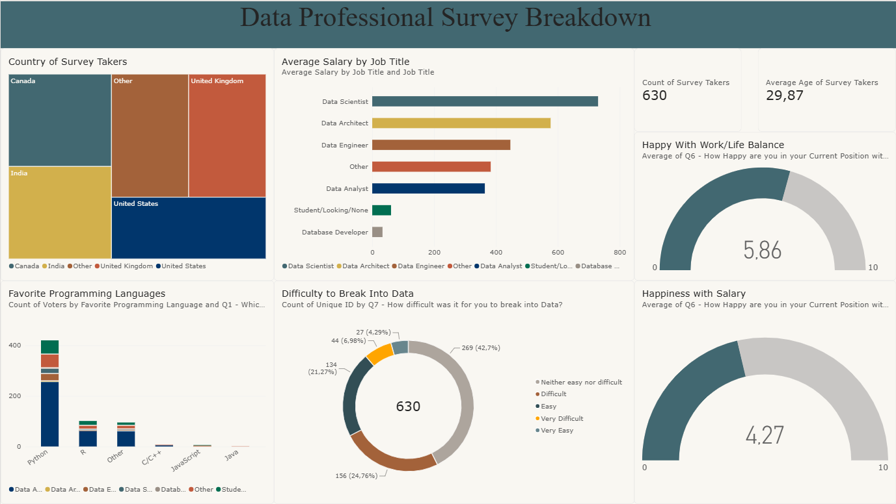

# 📊 Global Data Professional Survey — Power BI Dashboard

## 📌 Project Overview
In this project, I transformed raw survey data from **630 data professionals worldwide** using **Power Query (ETL)** and built an interactive **Power BI Dashboard**. The dashboard explores salary benchmarks across data roles, preferred programming languages, regional representation, career entry difficulty, and job satisfaction metrics.

📥 **[Download Power BI Report (`Final_Project.pbix`)](./Final_Project.pbix)**

---

## 🖥️ Dashboard Preview

---

## 🛠️ Power BI & ETL Skills Demonstrated
* **Data Transformation (Power Query):**
  * Cleaned open-ended categorical columns (grouped minor categories into `'Other'` for cleaner visualization across Job Titles, Countries, and Programming Languages).
  * Parsed salary range strings (e.g., `'41k-65k'`) by splitting delimiters and calculating midpoints to create a numerical `Average Salary` metric.
* **Data Visualization & KPI Design:**
  * **Treemap:** Geographic distribution of survey respondents (`United States`, `India`, `United Kingdom`, `Canada`).
  * **Clustered Bar & Stacked Column Charts:** Comparative analysis of average compensation by role and programming language preferences (`Python`, `R`, `SQL`, etc.) segmented by job title.
  * **Donut Chart:** Breakdown of perceived difficulty in breaking into the data industry.
  * **KPI Cards & Gauges:** High-level summary of total respondents (`630`), average age (`29.87`), Work/Life Balance satisfaction (`5.86 / 10`), and Salary satisfaction (`4.27 / 10`).

---

## 💡 Key Insights
1. **Compensation Leaders:** **Data Scientists**, **Data Architects**, and **Data Engineers** command the highest average salaries among surveyed professionals.
2. **Dominant Tech Stack:** **Python** is overwhelmingly the favorite programming language across all data roles, followed by **R**.
3. **Job Satisfaction Gap:** While professionals report a solid **Work/Life Balance score (5.86/10)**, satisfaction with **Salary lags behind (4.27/10)**, highlighting compensation growth as a primary motivator for career transitions.
4. **Barrier to Entry:** Around **42.7%** of respondents rated breaking into the data field as *"Neither easy nor difficult"*, while roughly **25%** found it *"Difficult"* or *"Very Difficult"*.
